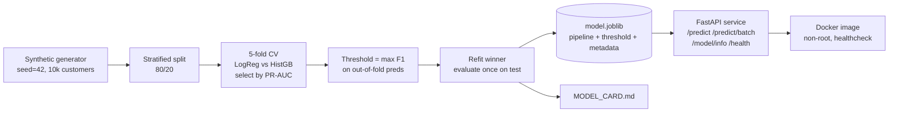

# fastapi-churn-prediction-service

A churn model built with scikit-learn and served as a validated, tested, Dockerised FastAPI service, with a model card generated from the actual training run.

[](https://github.com/SurajKumarrrrr/fastapi-churn-prediction-service/actions/workflows/ci.yml)

> **Data note:** the data is **synthetic**. It comes from a deterministic generator (`src/churn_service/data.py`, fixed seed) in which churn is drawn from a known logistic model. The numbers below show that the pipeline works and is evaluated correctly. They are **not** findings about real customers.

## Problem

A subscription business (telco, streaming, SaaS) wants to know which customers are likely to cancel so a retention team can reach out first. A model in a notebook doesn't help with that. It has to sit behind an API that other systems can call, reject bad input, report its own version and health, and come with a clear statement of what it can and can't be used for.

## Approach



- **Features:** tenure, contract type, monthly charges, internet service, payment method, senior flag, paperless billing, support tickets (90 days). Preprocessing (scaling, one-hot encoding) lives *inside* the scikit-learn `Pipeline`, so training and serving use exactly the same transformations.
- **Model selection:** logistic regression vs. histogram gradient boosting, compared with 5-fold stratified CV on the training set only. PR-AUC is the selection metric because churners are the minority class.
- **Threshold:** picked to maximise F1 on out-of-fold predictions, so the test set is touched exactly once.
- **One artifact:** pipeline, feature order, threshold and metrics are saved in a single joblib bundle so model and metadata can't drift apart.
- **API contract:** Pydantic v2 schemas with `Literal` enums, numeric bounds and `extra="forbid"`. Bad input gets a 422 with a precise error instead of a silent wrong prediction. If the model file is missing, the app still starts, `/health` reports `degraded` and prediction endpoints return 503, which is what an orchestrator needs to see.

## Results

From `make train` (seed 42, 8,000 train / 2,000 test customers, 32.8 % churn rate in training):

| candidate (5-fold CV) | ROC-AUC | PR-AUC |
|---|---|---|
| **logistic_regression** (selected) | 0.804 | 0.655 |
| hist_gradient_boosting | 0.797 | 0.640 |

Held-out test set, threshold 0.302:

| ROC-AUC | PR-AUC | Brier | Precision | Recall | F1 | Flagged |
|---|---|---|---|---|---|---|
| 0.798 | 0.640 | 0.168 | 0.523 | 0.794 | 0.631 | 49.7 % |

Permutation importance (drop in test PR-AUC): contract 0.101, tenure 0.087, support tickets 0.044, monthly charges 0.042, payment method 0.021; the rest are under 0.01.

What this shows:
- Logistic regression beats gradient boosting. That's expected here, because the generator *is* a logistic model with additive effects. The simpler model is easier to explain and wins on the metric, so it ships.
- The model recovers the generator's strongest drivers (contract and tenure) in the right order, which is a useful sanity check that the pipeline has no leakage or bugs.
- The max-F1 threshold flags about half of all customers. That's a lot for a real retention team, so the threshold should really come from offer cost vs. customer value (see *What I'd do next*).

Serving (local uvicorn, single worker, `scripts/smoke_test.py` with 200 fresh customers from a different seed): **p50 7.1 ms, p95 10.1 ms** per `/predict` request; one `/predict/batch` call with all 200 customers took **14.1 ms**. 107 of 200 were flagged. Measured on the build sandbox, so treat this as a rough figure.

Tests: 24 passing (`pytest -q`), ruff clean. The full numbers are in [`MODEL_CARD.md`](MODEL_CARD.md).

## How to run

```bash
make install          # pip install -r requirements-dev.txt -e .
make train            # trains, writes artifacts/ and MODEL_CARD.md
make test             # pytest
make run              # uvicorn on :8000, docs at http://localhost:8000/docs
make smoke            # in a second terminal: latency + sanity check
```

Example request:

```bash
curl -X POST localhost:8000/predict -H 'Content-Type: application/json' -d '{
  "tenure_months": 3, "contract": "month_to_month", "monthly_charges": 89.9,
  "internet_service": "fiber", "payment_method": "electronic_check",
  "senior_citizen": false, "paperless_billing": true, "support_tickets_90d": 2}'
# {"churn_probability":0.8391,"will_churn":true,"risk_band":"high","model_version":"1.0.0+seed42","threshold":0.3022}
```

Docker (the image trains its own model at build time; CI builds it and calls `/health` and `/predict` on every push):

```bash
make docker-build && make docker-run
```

| endpoint | purpose |
|---|---|
| `GET /health` | liveness/readiness: `ok` or `degraded` |
| `GET /model/info` | model name, version, threshold, features, test metrics |
| `POST /predict` | score one customer |
| `POST /predict/batch` | score up to 1,000 customers in one call |

## Project structure

```
src/churn_service/
  data.py         deterministic synthetic customer generator
  features.py     feature lists + candidate pipelines
  train.py        CV model selection, threshold tuning, evaluation, artifact
  model_card.py   renders MODEL_CARD.md from the training report
  schemas.py      Pydantic request/response contracts
  predictor.py    loads the bundle, scores customers, risk bands
  api.py          FastAPI app factory (lifespan model loading, 503 handling)
scripts/smoke_test.py   latency + sanity check against a running server
tests/                  data, training and API tests (24)
Dockerfile, Makefile, .github/workflows/ci.yml
```

## What I'd do next

- Replace the F1 threshold with a cost-based one (offer cost vs. expected saved customer value) and expose it as config.
- Load the model from a registry (MLflow) by version instead of baking it into the image, so you can roll back without a rebuild.
- Log inputs and predictions, then add drift monitoring (e.g. PSI per feature) and a scheduled retrain.
- Per-group evaluation (e.g. `senior_citizen`) as a fairness check before any real use.
- Calibrate probabilities (isotonic) if the scores feed into expected-value calculations.

## Interview notes

- **Why a pipeline in one artifact?** Preprocessing inside the scikit-learn `Pipeline` rules out training/serving skew. Bundling the threshold and feature order with it means the API can't run an old threshold against a new model.
- **Why PR-AUC and an out-of-fold threshold?** With about 33 % positives, ROC-AUC looks good too easily. PR-AUC reflects how useful the flagged list really is. Tuning the threshold on CV predictions keeps the test set a clean, one-time estimate.
- **Why did the simpler model win, and is that OK?** The data has additive effects, so logistic regression fits it well. I let CV decide instead of assuming boosting is better, and the simpler model is also easier to explain to a business stakeholder.
- **Why strict validation?** `extra="forbid"` and enums mean a typo in a field name or category gives a 422, not a confident prediction made on defaults. That's the most common silent failure in ML APIs.
- **Operational behaviour:** the app starts without a model and reports `degraded`, so Kubernetes or Docker can tell "process alive" from "ready to serve". Every response carries `model_version` for traceability.
